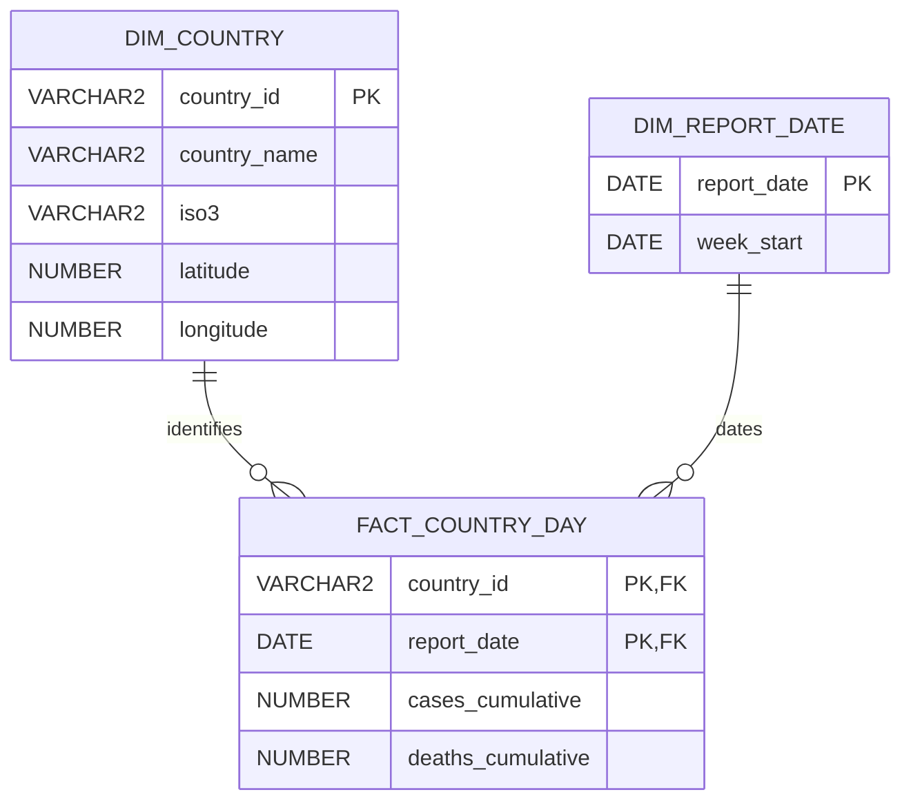

# Reporting star schema

The fact contains one row per JHU reporting location per date, including a row when one or both source observations are unavailable. A missing count is `NULL`. Latitude, longitude, and ISO alpha-3 codes are available where the geographic reference supports them. The calendar uses Monday as the first day of the reporting week.

`v_country_daily` derives signed daily changes and trailing seven-day means, and reconstructs cumulative values from the changes using window functions. Each first observed snapshot after a gap supplies a new cumulative baseline. `v_country_weekly` rolls daily changes up by location and week and includes the number of available case and death changes. The Python pipeline exports the same metrics for Power BI and the browser dashboard.
